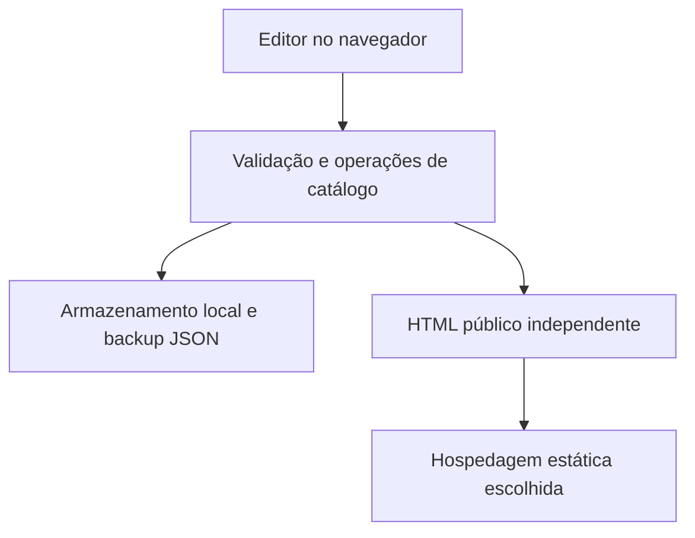

# Arquitetura

Decisão: núcleo estático em módulos ECMAScript nativos, JavaScript com contratos JSDoc e `checkJs`, build Node.js e dados JSON v1. Não há servidor de aplicação, banco, API ou autenticação. Consulte [ADR-001](adr/001-static-core.md) e [estado verificado](../STATUS.md).

## Responsabilidades

| Unidade | Responsabilidade e limite |
| --- | --- |
| `src/core.js` | Normaliza dados, limita tamanho, valida relações, preços e URLs; busca e persistência. Não acessa rede. |
| Editor | Converte entradas de formulário em dados válidos; apresenta erros, prévia e ações de arquivo. Armazenamento é local à origem. |
| `src/export.js` | Serializa dados escapados e gera HTML público, estilo e comportamento embarcados; incorpora ilustrações locais fornecidas pelo chamador. |
| `src/examples.js` / `public/assets/` | Dois catálogos fictícios e ilustrações próprias. |
| `qrcode-generator` 2.0.4 | Gera QR localmente; o build copia a distribuição para `dist/vendor/qr.js`, preservando a licença. Nenhuma CDN é necessária. |
| `scripts/build.mjs` | Monta `dist/`, os dois HTMLs públicos e seus JSONs. `_headers` é uma configuração para provedores compatíveis, não uma garantia universal. |

## Contrato de dados

`Catalog`: `version:1`, `id`, `name`, `description`, `segment`, `theme`, `logo`, `publicUrl`, `categories`, `products`. Segmentos: `restaurant` e `retail`; temas: `forest`, `terracotta`, `midnight`.

Categoria: `id`, `name` e `parentId` opcional. Produto: `id`, `name`, `description`, `categoryId`, `priceCents`, `available`, `image`, `variants`. Variação: `name` e `priceCents`; seu preço é um valor completo, não um adicional calculado. Não há quantidade nem controle de estoque. Identificadores são únicos por coleção, relações devem existir e categorias não podem formar ciclos.

Preços usam centavos inteiros, de zero a 100.000.000. Limites atuais: 200 categorias, 1.000 produtos, 30 variações por produto e JSON de 10 MiB. Esses são limites de validação, não uma promessa de desempenho ou capacidade do armazenamento do navegador. Campos desconhecidos são descartados; versões diferentes de 1 são rejeitadas. O validador executável é a fonte do contrato, sem dependência de um servidor de schema.

A importação valida antes da substituição do trabalho. `localStorage` usa `vitralibre-v1` e `vitralibre-v1-backup`; a cópia anterior válida permite recuperação de corrupção. Falhas de quota ou bloqueio são apresentadas ao usuário. O carregamento também lê as chaves legadas `vitrine-aberta-v1` sem apagar os dados anteriores. Há detecção otimista de mudança por outra aba e bloqueio de sobrescrita divergente com opção de backup/recarga. Não há fusão concorrente nem sincronização entre dispositivos; escritas exatamente simultâneas não têm transação distribuída. Não existe garantia de retenção pelo navegador; JSON baixado é a cópia portátil.

## Exportação e publicação

O HTML público tem dados serializados com escape de encerramento de script e textos tratados como conteúdo. Ele inclui busca/filtros e não contém o editor. Imagens raster em base64 e ilustrações próprias são portáteis; URLs de imagens permanecem externas. A exportação falha se uma ilustração própria não puder ser incorporada, em vez de criar referência local quebrada.

A URL pública é fornecida pelo usuário após o deploy. Não existe endpoint que envie automaticamente os dados locais à hospedagem. QR e compartilhamento apontam para essa URL; não carregam o JSON dentro do código.

## Evolução

Um módulo dinâmico exigirá outro ADR e API versionada. Autorização, isolamento por tenant, migrações, mídia e backups devem ocorrer no backend, nunca por confiar em campos enviados pelo cliente. O P0 não contém endpoints fictícios nem flags que sugiram capacidades operacionais de P1/P2.
